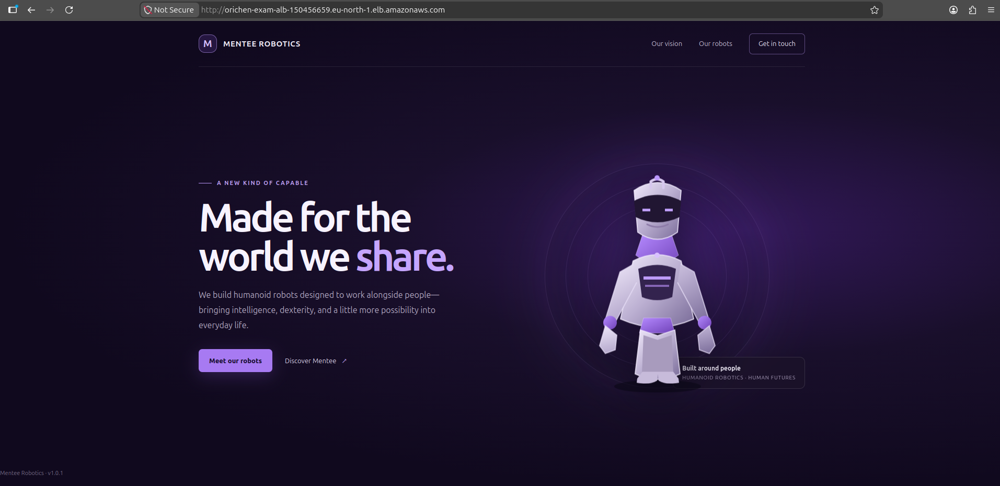

### Decisions

**Decouple App from Infra**

The most recent state of the terraform configuration in git should idealy always represent the state of the infrastructure. Decoupling app versioning from infra versioning makes it easier to roll back a version or develop on different environments.

The pipelines are seperated:
* Deploy - Deploys terraform configuration on push to terraform folder. That way the state in git is the same as in aws (though there is no reconciliation loop, can use cron feature of action)
* Build - Build and tag the commit on changes in app or dockerfile. If only the Dockerfile changes a patch bump is forced, otherwise the commit message determines bump.

In the future it would be nice to use github environments to create a dev environment using the same pipelines. In that case automatically changing the "image" variable in terraform would be desired.

**Infra Architecture**

In this demo a terraform configuration creates ecs cluster, service and taskDefinition as well as VPC,subnets and general network configuration. In reality it would be expected that different teams may maintain different services on the same infrastructure. Some of this deployment like VPC might be in jurisdiction of a different team. Or if we were deploying to a k8s cluster a different team would maintain the cluster and give greenfield team some permissions in an ArgoCD instance.

The containers are created in a private subnet and exposed to the world using an Application Load Balancer (ALB) on the public subnet. The LB is using http but it would be better if we issued a certificate using ACM and configured it to use tls termination.

    

